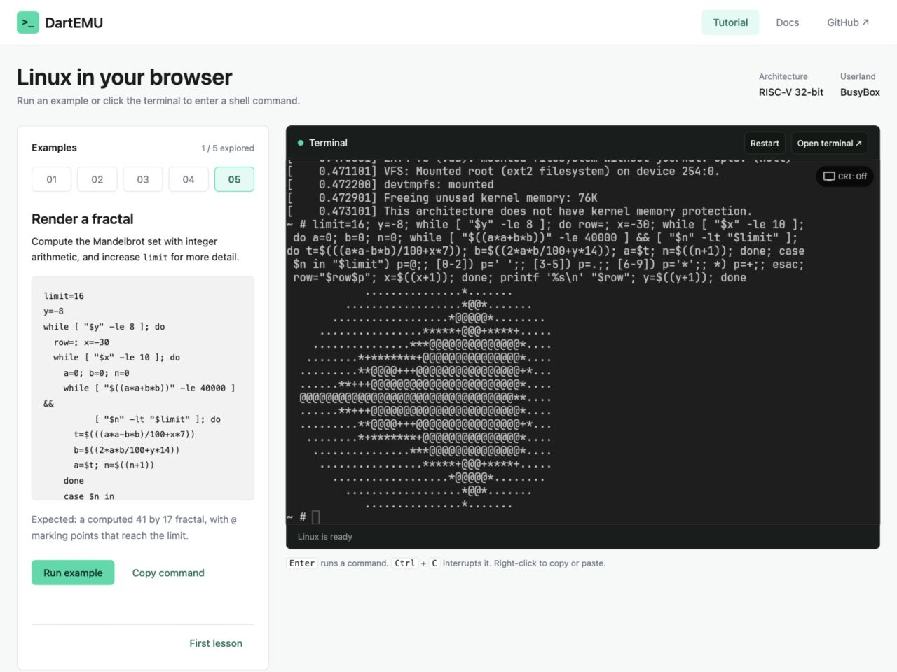

# dart_emu

[![style: very good analysis][very_good_analysis_badge]][very_good_analysis_link]
[![License: MIT][license_badge]][license_link]

A RISC-V system emulator in pure Dart. Boot Linux, run commands, and restore
VM snapshots on native Dart or in a browser.

Ported from [TinyEMU](https://bellard.org/tinyemu/) by Fabrice Bellard.

**[Learn DartEMU with a live Linux machine →](https://leematthewhiggins.github.io/DartEMU/)**

[](https://leematthewhiggins.github.io/DartEMU/)

Run five examples in an RV32 Linux guest, including a Mandelbrot fractal
computed by the guest shell. No login or installation is needed. Restarting
discards guest files. The
[written tutorial](docs/browser-tutorial.md) has commands and expected output.

GitHub Pages publishes from `main`. The
[Firebase demo](https://dartemu-3ef91.web.app/?boot=32) is also available.

```dart
final sandbox = AgentSandbox(SandboxConfig(
  kernelData: kernel, rootfsData: rootfs, biosData: bios,
));

await sandbox.boot();
try {
  final result = await sandbox.exec('uname -m');
  print(result.stdout); // riscv64 with matching RV64 images
} finally {
  await sandbox.dispose();
}
```

## Why this exists

DartEMU interprets guest instructions and boots a separate kernel. It needs
no native emulator binary, hardware VM extensions, privileged daemon or
Docker. Use it for browser lessons, disposable test environments, or running
model-authored code.

Host access comes through disk, filesystem and network backends. Isolation
still depends on the emulator, Dart runtime and those backends working
correctly; it is not a guarantee against emulator bugs.

## What it does

- **RV64IMAFDC and RV32IMAFDC**, all privilege levels (M/S/U), SV39 and SV32
  virtual memory with hardware page-table walking
- **Boots Linux** — bundled legacy kernels use BBL; Linux 6.12 builds use
  the emulator's built-in SBI v2.0 support
- **VirtIO** console, block, network and 9P, plus CLINT, PLIC and HTIF
- **User-mode networking** with ARP, DHCP, DNS, ICMP, TCP and UDP, and a
  swappable backend that decides what the guest can reach
- **Runs in a browser** — RV32 on any web backend, RV64 under WasmGC
- **`AgentSandbox`** for running commands under wall-clock and instruction
  budgets, with file exchange and snapshot/restore
- **[AgentOS](agentos/)** — an image whose console *is* an agent, with no
  shell behind it and no credential in it
- **YAML configuration** and `.zip` bundles that carry a whole machine

## Try it

[Open a standalone terminal](https://leematthewhiggins.github.io/DartEMU/terminal.html?boot=32)
or [choose an image](https://leematthewhiggins.github.io/DartEMU/terminal.html).

To run locally, install Dart 3.9 or later and use the images included in the
checkout. The CLI writes to its disk image, so make a working copy first:

```sh
git clone https://github.com/LeeMatthewHiggins/DartEMU
cd DartEMU
dart pub get --no-example
mkdir -p .dart_tool/demo
cp example/assets/root-riscv64.bin .dart_tool/demo/rootfs.bin
dart run bin/dart_emu.dart run \
  --bios example/assets/bbl64.bin \
  --kernel example/assets/kernel-riscv64.bin \
  --drive .dart_tool/demo/rootfs.bin \
  --cmdline "console=hvc0 root=/dev/vda rw"
```

Wait for the `~ #` shell prompt, then try `uname -m`. Press Ctrl+C to exit
the CLI. Changes remain in `.dart_tool/demo/rootfs.bin`; copy the bundled
image again to reset it. The `data/alpine*.yaml` configs require additional
[locally built images](docs/images.md).

The [RV64 demo](https://dartemu-3ef91.web.app/?boot=64)
ships a C compiler, so browsers with WasmGC can compile and run C in the tab.

The same app can also be hosted on a fork. See the
[Pages deployment instructions](example/README.md#github-pages).

## Install

```sh
dart pub add dart_emu                      # as a library
dart pub global activate dart_emu          # as a CLI
```

## How it fits together

```
your program
     │
     ├── Emulator ──────────── lifecycle, console streams, stepFor()
     └── AgentSandbox ──────── boot, exec under budgets, snapshot
              │
        RiscVMachine ───────── CPU ▸ MMU ▸ memory map ▸ devices
              │
     ┌────────┼────────┬──────────────┐
  BlockDevice │  NinePBackend    NetBackend        ← the seams
   memory     │   directory       real sockets
   file       │   in-memory       browser proxy
              │   browser folder
        CharacterDevice
```

Choose the entry point for your platform:

| Import | Use when |
| --- | --- |
| `package:dart_emu/dart_emu.dart` | anywhere, including web |
| `package:dart_emu/dart_emu_io.dart` | server, desktop, CLI |
| `package:dart_emu/dart_emu_web.dart` | browser |

The CPU and device interfaces are platform-neutral. Conditional imports
select native sockets or the browser HTTP backend; file-backed devices and
configuration loading are exposed through `dart_emu_io.dart`.

## Documentation

| Guide | What it covers |
| --- | --- |
| **[Browser tutorial](docs/browser-tutorial.md)** | First boot, guided shell examples, controls and troubleshooting |
| **[Architecture](docs/architecture.md)** | Layers, every interface, where the boundaries are, how a request leaves a browser guest |
| **[Agents](docs/agents.md)** | `AgentSandbox` and AgentOS, budgets, snapshots, the credential design |
| **[Networking](docs/networking.md)** | The TCP/IP stack, backends, the browser proxy, credential injection |
| **[Filesystems](docs/filesystems.md)** | Block devices, 9P shares, backends, containment |
| **[Configuration](docs/configuration.md)** | Every YAML key, bundles, the CLI, building configs in code |
| **[Embedding](docs/embedding.md)** | Flutter, the web target, driving emulation from a `Ticker` |
| **[Building images](docs/images.md)** | Root filesystems, modern kernels, booting without firmware |
| **[Performance](docs/performance.md)** | Throughput, download size, benchmarking, measuring a change |

Also: [`example/`](example/) is a complete Flutter app, and
[`agentos/`](agentos/) is the in-guest agent.

## Performance

Best of 3 on an Apple M3 Pro, Dart 3.12.2 — host-specific, so re-run the
suite rather than trusting the table:

| Workload | RV64 | RV32 |
| --- | --- | --- |
| boot to shell | **0.57 s** | **0.54 s** |
| sha256 of 1 MB | 109 MIPS | 158 MIPS |
| gzip 512 KB | 108 MIPS | 131 MIPS |
| pipes + context switches | 91 MIPS | 113 MIPS |

A separate recorded snapshot benchmark restored in 29 ms against a 1.1 s
cold boot (~37x). RV32 was faster in the workloads above; timings depend on
the host, runtime and guest image.

More, including how to measure a change without fooling yourself, in
[Performance](docs/performance.md).

## Contributing

```sh
dart pub get --no-example
dart test                                    # unit tests
dart test --run-skipped -t machine           # whole-machine tests
dart test --run-skipped -t sandbox           # boots a guest
dart test -p chrome test/net                 # browser-only paths
dart analyze --fatal-infos --fatal-warnings lib test
```

The sandbox suite needs the additional images described in
[Building images](docs/images.md#prebuilt-images); unavailable-image tests
are skipped.

Commits follow [Conventional Commits](https://www.conventionalcommits.org).
CI runs analysis, formatting, a 50% coverage floor, spell-check, the C
agent's tests and a riscv64 cross-compile.

## Licence

The `dart_emu` source is MIT licensed (see [LICENSE](LICENSE)).

The prebuilt **guest images** in `example/assets/` are a separate matter:
they bundle third-party software under its own terms — notably the Tiny C
Compiler (LGPL-2.1-or-later), BusyBox (GPL-2.0-only), musl libc (MIT), a
Linux kernel (GPL-2.0-only) and JetBrains Mono (OFL-1.1). See
[THIRD_PARTY_NOTICES.md](THIRD_PARTY_NOTICES.md) for sources and pinned
revisions.

The emulator source remains MIT licensed when you supply your own guest
images; those images and your other dependencies keep their own licences.

[license_badge]: https://img.shields.io/badge/license-MIT-blue.svg
[license_link]: https://opensource.org/licenses/MIT
[very_good_analysis_badge]: https://img.shields.io/badge/style-very_good_analysis-B22C89.svg
[very_good_analysis_link]: https://pub.dev/packages/very_good_analysis
